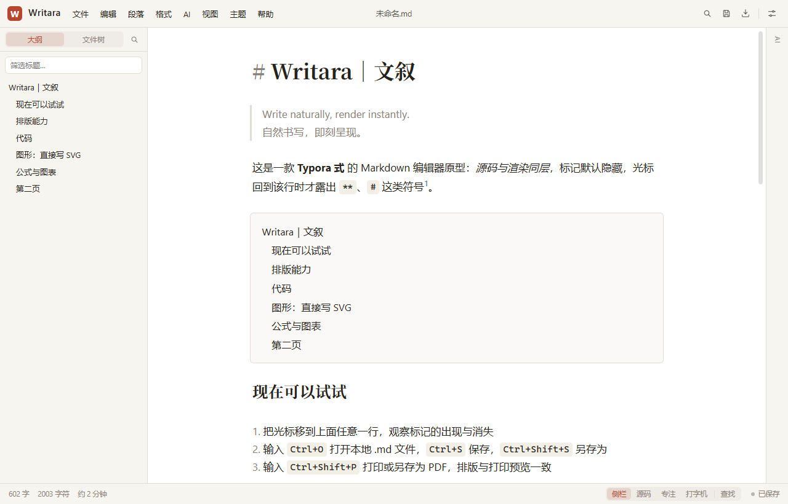

# Writara｜文叙

> Write naturally, render instantly. 自然书写，即刻呈现。

Typora 式的 Markdown 编辑器，Web / PWA / Electron 桌面端同一套代码。核心是**源码与渲染同层**：
CodeMirror 6 自绘即时渲染，`**`、`#`、表格、公式这些标记默认隐藏，光标回到该行时才露出源码。
不是富文本 WYSIWYG——文件里始终是干净的 Markdown。



## 能力

- **即时渲染**：标题、列表、引用、表格、任务列表、脚注、定义列表、KaTeX 公式、Mermaid 图表、
  SVG 与 HTML 块都在编辑器里直接呈现；代码块按语言高亮，90+ 种围栏语言补全。
- **排版与导出**：A4 版面预览，屏幕与纸面共用一套字体/间距；导出 PDF、PNG、单文件 HTML，
  以及经 Pandoc 的 Word / ePub。长表格跨页重复表头，标题不孤行，`<!-- pagebreak -->` 控制分页。
- **工作区与项目**：文件夹树、大纲、全文搜索；项目模式用 `.writara/project.json` 定义章节顺序、
  排除目录与导出方式，支持合并导出和逐章导出。
- **文件安全**：桌面端直接读写本地磁盘，保存前比对磁盘、避免静默覆盖；自动保存只在已授权时写盘；
  支持 UTF-8 / UTF-16 / GB18030 编码与 CRLF/LF 换行；删除文件可在提示条里撤销。
- **写作流水线**：文档体检（结构 / 语言 / 链接 / 风格）、分节初稿、提案收件箱、反 AI 腔标记；
  AI 只调用本机的 coding-agent CLI（OpenCode / Claude Code），不保存任何模型凭据。
- **桌面端**：原生菜单、文件关联、外部修改监听、在线更新（GitHub Releases）。

## 下载

到 [Releases](https://github.com/NBullet/Writara/releases) 下载 Windows 安装包。

- **安装版**（NSIS）支持在线更新；`portable` 单文件版不支持。
- 当前安装包**未签名**，首次运行可能出现 SmartScreen 提示。
- macOS / Linux 已配置构建目标，但尚未实际打包验证。

## 开发

需要 Node.js 22+。

```bash
npm install
npm run dev            # Web 版，默认 http://localhost:5173
npm run dev:electron   # 桌面端（先编主进程，再起 Vite + Electron）
```

| 目的 | 命令 |
| --- | --- |
| 类型检查 | `npm run typecheck` |
| Lint | `npm run lint` |
| 全部测试 | `npm test` |
| 单文件测试 | `npx vitest run src/markdown/render.test.ts` |
| 打印预览 | `http://localhost:5173/?print=1` |
| 构建 Web | `npm run build` |
| 构建桌面端 | `npm run build:electron` |
| 打安装包 | `npm run package` |
| 发布到 GitHub Releases | `npm run release`（需要 `GH_TOKEN`） |

收尾按 `npm run lint && npm run typecheck && npm test`；`vite build` 的 500 kB chunk 警告属正常
（CodeMirror + React + KaTeX），不是回归。

## 发布与更新

```powershell
$env:GH_TOKEN = "<有 repo 权限的 token>"
npm run release
```

`electron-builder` 会构建 NSIS 安装包和便携版，生成 `latest.yml`，在 GitHub 上创建**草稿** release。
到网页上把草稿发布，`electron-updater` 才能看到新版本（它只认已发布的 release）。

- 版本号只改 `package.json` 一处；关于页通过构建时注入的 `__WRITARA_VERSION__` 读取。
- 安装包未签名，因此 `electron-builder.yml` 里显式关掉了更新包的 Authenticode 校验；
  签名之后要删掉 `win.verifyUpdateCodeSignature: false`，让更新校验发布者。
- `latest.yml` 里的文件名是连字符版（`Writara-Setup-0.2.0.exe`）；`npm run release` 会自动改名上传。

## 目录

```
electron/          主进程：窗口、文件 IPC、打印/PDF、Pandoc、在线更新
src/editor/        CodeMirror 扩展与即时渲染（live-preview/）
src/markdown/      Markdown 渲染、表格、公式编号、锚点、清洗
src/export/        打印 / PDF / PNG / Word / ePub / 项目导出
src/components/    外壳 UI（菜单栏、侧栏、对话框、提示层）
src/ai/            写作流水线、文档体检、提案、反 AI 腔
src/project/       项目清单、顺序、指令文件
src/platform/      文件层（浏览器 File System Access / Electron IPC）
docs/              排版对齐、焦点视图、项目模式等设计记录
```

架构约束、渲染规则和已知差距见 [`AGENTS.md`](AGENTS.md) 与 [`docs/`](docs)。

## 状态

0.2.0 是首个公开版本，仍在快速迭代：合并单元格、图片上传、版本历史、多标签页、云同步、
macOS 打包验证等尚未完成。详细清单见 `AGENTS.md` 的「未实现」一节。

## 作者

NBullet · [nbullet@126.com](mailto:nbullet@126.com) · [GitHub](https://github.com/NBullet/Writara)

目前尚未添加开源许可证文件；在补上 `LICENSE` 之前，默认保留所有权利。
